# README

[](https://www.ruby-lang.org/)
[](https://rubyonrails.org/)
[](https://github.com/KeyHarbour/KeyHarbourCE/releases)

[](https://github.com/KeyHarbour/KeyHarbourCE/actions/workflows/ci.yml)
[](https://github.com/KeyHarbour/KeyHarbourCE/blob/main/.github/dependabot.yml)
[](https://github.com/KeyHarbour/KeyHarbourCE/blob/main/LICENSE.md)


# KeyHarbour Communauty Edition (KeyHarbourCE)

KeyHarbourCE is a robust enterprise management platform built with **Ruby on Rails 8**, designed for maximum security and optimal performance through a containerized architecture. It natively integrates PostgreSQL for data persistence and Meilisearch for an ultra-fast search experience.

💡 **Get Started & Feature Activation**

KeyHarbourCE is completely free to use and test in any non-production environment. Please note that certain advanced features within this Community Edition are locked by default; you can easily unlock them for your testing by activating a free trial. Do not hesitate to request your trial key or ask about our Enterprise Edition by contacting us at [[Support](https://keyharbour.atlassian.net/servicedesk/customer/portal/1/group/71/create/143)].


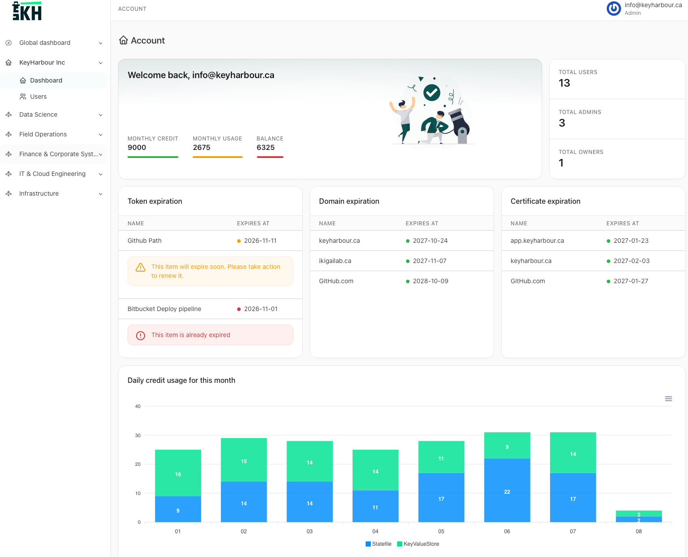
---

## 🚀 Key Features

* **Rails 8 Engine**: Modern, high-performance web structure (Propshaft, Importmaps, and Stimulus).
* **High-Performance Search**: Full out-of-the-box integration with Meilisearch.
* **Hardened Security**: At-rest data encryption powered by Active Record Encryption.
* **Production Ready**: Optimized Docker multi-stage build setup and native compatibility with Kamal.

### 🏢 Hierarchical RBAC & Strict Environment Data Isolation

KeyHarbourCE implements a robust, multi-tenant hierarchical permission model coupled with an absolute security boundary down to the environment level, ensuring bulletproof access control and preventing cross-contamination.

- **Enterprise Governance Hierarchy:** Access control is structured across three cascading layers:
  - **Organization Level:** The highest boundary to manage global compliance, billing, and top-level administrative access.
  - **Project Level:** Logical groupings within an Organization (e.g., *E-Commerce Platform*, *Data Engineering*). Permissions granted here automatically cascade down.
  - **Workspace Level:** The finest granularity for separating specific scopes and teams.
- **Hierarchical Environment Selection:** Environments (e.g., *Development*, *Staging*, *Production*) can be defined and customized at the Organization, Project, or Workspace level, giving you total flexibility to enforce different deployment lifecycle rules where they make sense.
- **Airtight Data & Secret Segregation:** Within any designated environment, secrets, and configuration item are architecturally walled off. A leak or misconfiguration in a lower environment can never affect or expose production data.
- **Cryptographic Token Binding:** Access rules, API keys, and pipeline tokens are bound directly to their designated hierarchy and environment, ensuring that production secrets remain strictly inaccessible to unauthorized systems or developers.

| Enterprise Governance Hierarchy | Hierarchical Environment Selection |
| :---: | :---: |
| 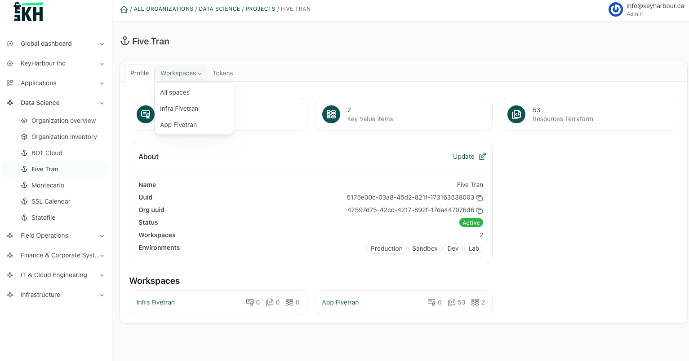 | 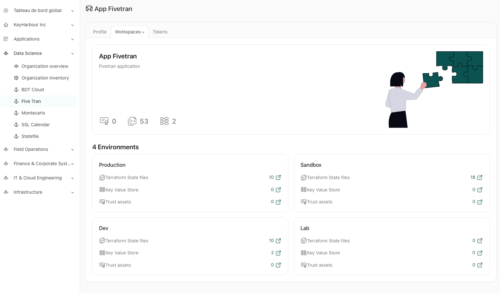 |

<h3>
  
  Secure Terraform State File Storage & Management
</h3>

KeyHarbourCE acts as a centralized, secure, and production-ready backend for your **Terraform State Files**, eliminating the need for complex cloud-specific storage setups. Beyond native Terraform commands, it provides an intuitive interface to easily manipulate your state.

- **Advanced State Manipulation:** Effortlessly create snapshots, backup your states, or manually add and remove specific resources directly through the platform, bridging the gap between raw CLI tools and user-friendly management.
- **Custom Version Tagging:** Assign specific version tags (e.g., `v1.0.0-stable`, `pre-migration-backup`) to critical state revisions, making it easy to bookmark milestones, freeze deployment states, or pinpoint stable infrastructure baselines.
- **State Locking:** Prevents race conditions and state corruption by automatically locking the state during concurrent `terraform apply` operations.
- **At-Rest Encryption:** Leverages Rails 8's native Active Record Encryption to ensure your infrastructure secrets and state data are safely encrypted before touching the database.
- **Version Control & Backups:** Keeps a full historical track of your state files, allowing you to audit changes, trigger automated backups, and roll back safely if an infrastructure deployment goes wrong.


| Version Control & Backups | Advanced State Manipulation |
| :---: | :---: |
| 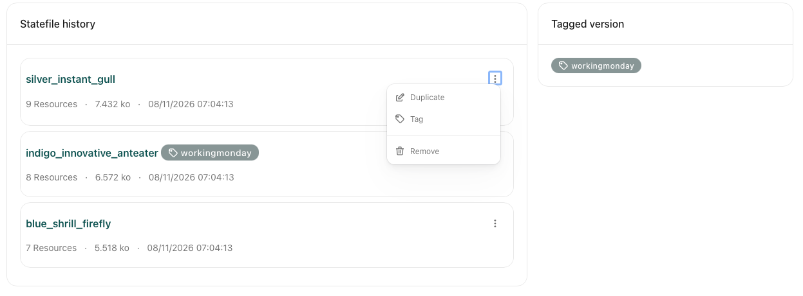 | 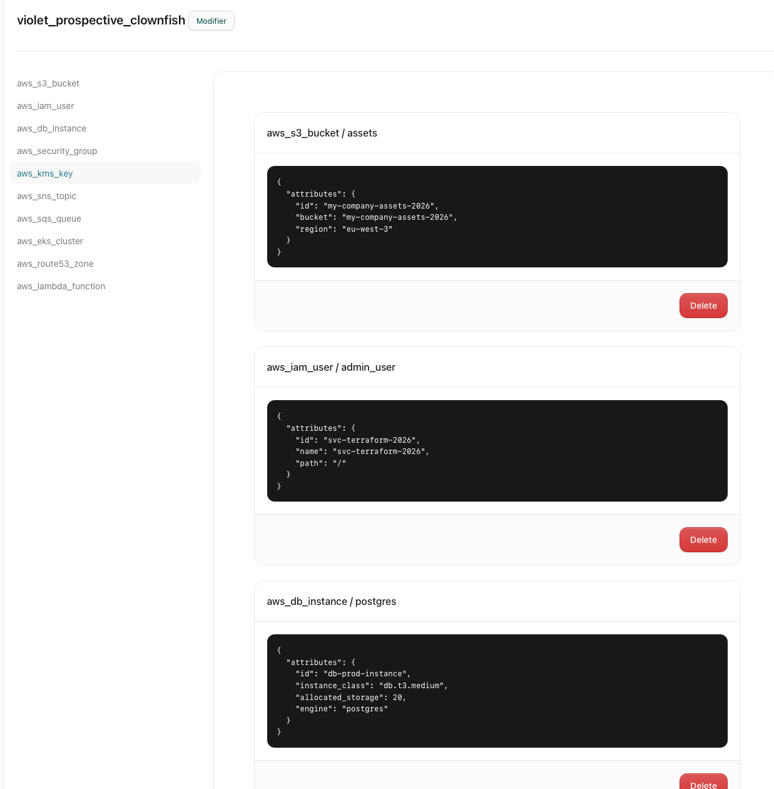 |


<h3>
  
  TrustAssets: Domain, SSL, and Token Lifecycle Tracking
</h3>

KeyHarbourCE introduces **TrustAssets**, a built-in inventory system designed to monitor and secure your external tech debt by keeping a continuous watch over expirations and lifecycle events.

- **Unified Asset Inventory:** Centralize and catalog all your critical infrastructure assets, including domain names, SSL/TLS certificates, and API tokens or credentials, in a single pane of glass.
- **Smart Expiration Alerts:** Prevent unexpected outages or service disruptions with proactive tracking that monitors expiration dates and alerts you before your domains or certificates lapse.
- **Token & Credential Governance:** Keep track of internal and third-party token lifetimes, ensuring no orphaned keys are left active and that rotation schedules are enforced.
- 
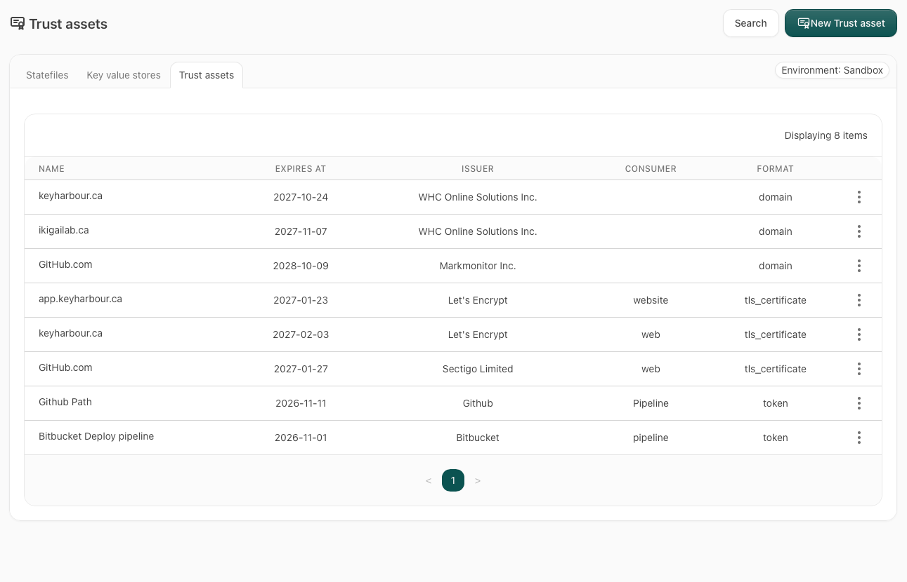

<h3>
  
  Smart License Lifecycle Management
</h3>

KeyHarbourCE provides a comprehensive tracking and compliance system for all your software licenses, allowing your team to optimize costs and stay audit-ready.

- **Centralized License Inventory:** Keep a clear, structured record of all internal, commercial, and open-source licenses used across your organization's projects and infrastructure.
- **Compliance & Optimization:** Track seat allocations and usage metrics to detect underutilized software seats, avoiding over-purchasing and optimizing your IT budget.
- **Renewal & Expiration Guard:** Stay ahead of maintenance contracts and subscription renewals with automated tracking, ensuring your teams never lose access to critical tools.
- **Smart License Lifecycle Management:** Keep a clear, structured record of all internal, commercial, and open-source licenses used across your organization. Track seat allocations and usage metrics to detect underutilized software, optimize your IT budget, and stay ahead of maintenance contract renewals.
- **Quote Comparison & Procurement Optimization:** Centralize multi-vendor price quotes during software or infrastructure procurement. Directly compare renewal offers against new proposals to ensure your team always secures the most cost-effective option before signing off on a purchase.


| Centralized License Inventory | Smart License Lifecycle Management | Quote Comparison & Procurement Optimization|
| :---: | :---: | :---: |
| 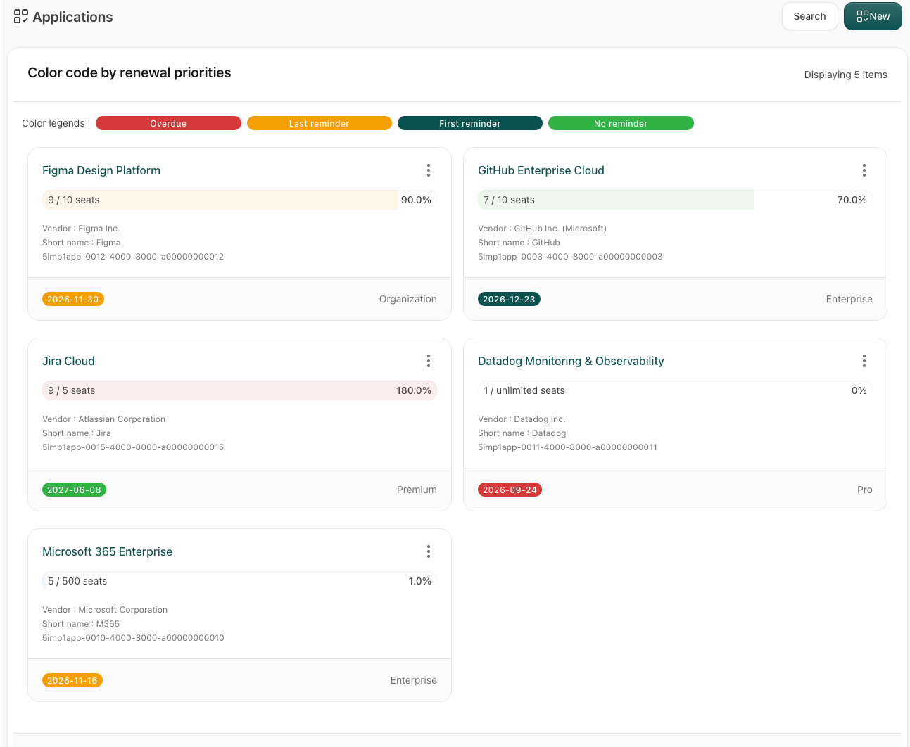 | 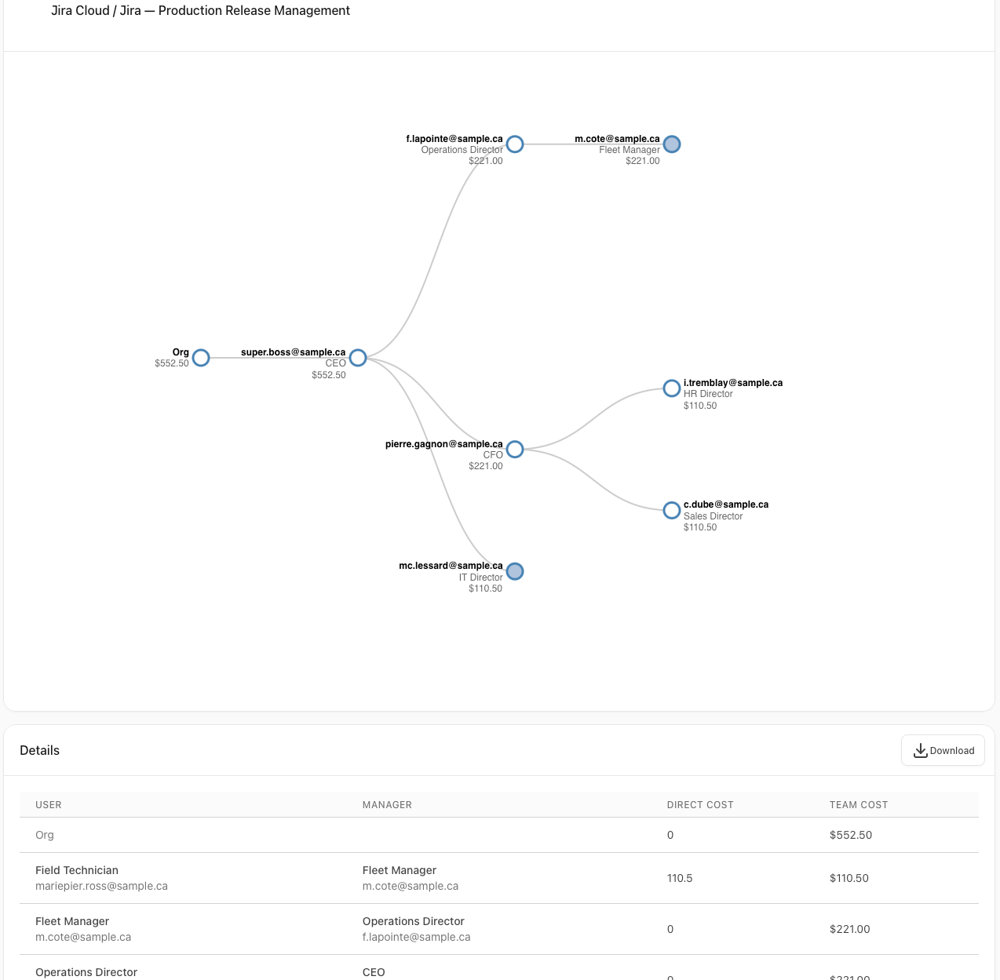 | 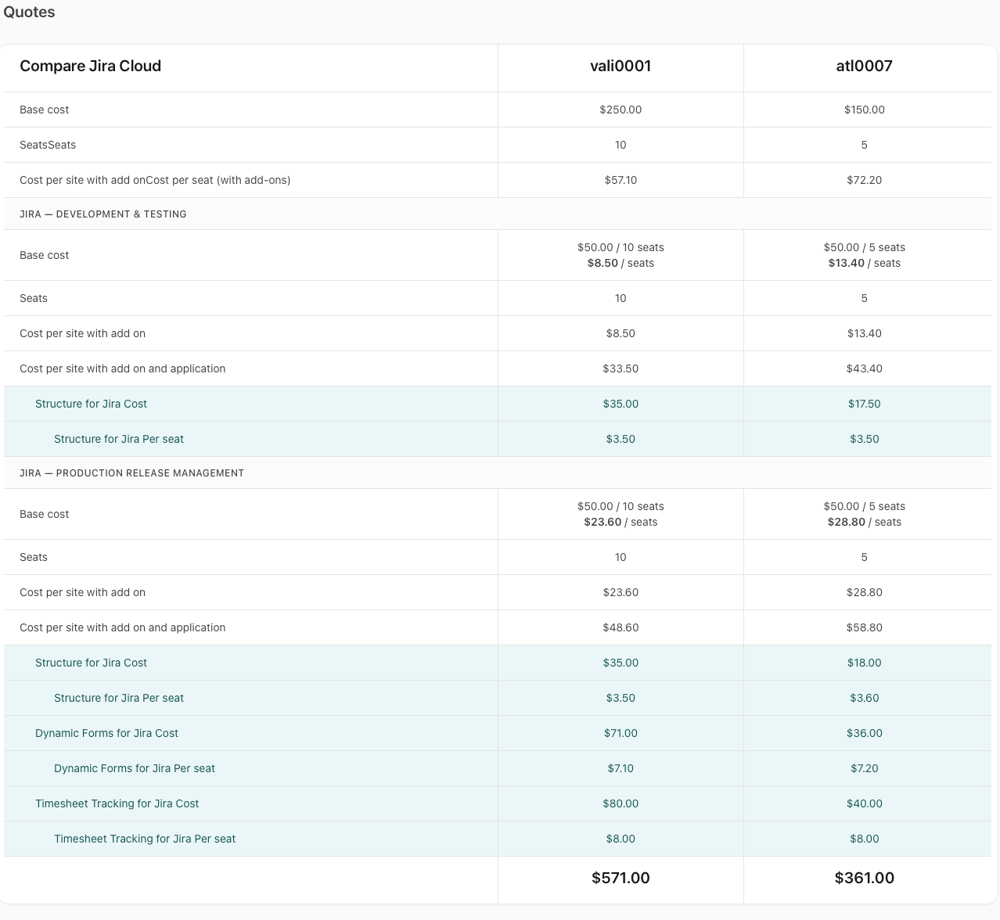 |


<h3>
  
  Secure Key-Value & Pipeline Artifact Store
</h3>

KeyHarbourCE includes a highly flexible and secure **Key-Value Store** tailored for modern CI/CD pipelines, allowing you to manage configurations, secrets, and metadata dynamically.

- **Encrypted or Plaintext Storage:** Choose between storing standard configuration metadata in plaintext or leveraging native database encryption to safely house pipeline secrets, API tokens, and sensitive variables.
- **One-Time Read (Ephemeral Data):** Enforce strict security for sensitive tokens or credentials by configuring them as "one-time read". Once retrieved by a pipeline or user, the record is immediately and permanently purged from the system.
- **Pipeline Artifact Integration:** Easily store, retrieve, and share ephemeral data, build flags, or deployment states across different stages of your pipelines or between separate environments.

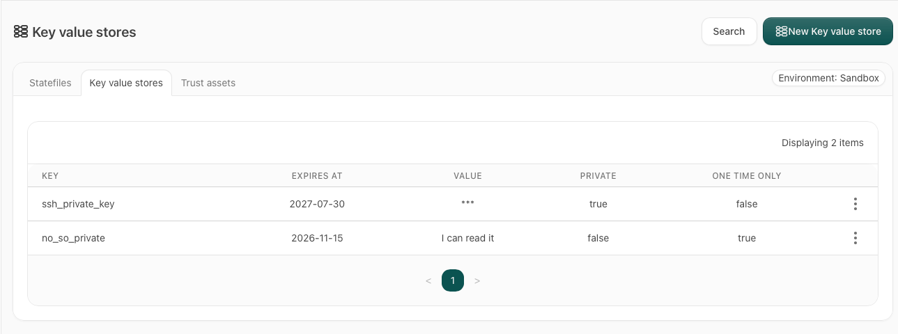

### 💻 KeyHarbour Unified CLI (`kh`)

KeyHarbourCE comes with a powerful, lightweight Command Line Interface (`kh`) designed to seamlessly bridge your terminal, automated scripts, and CI/CD pipelines with the platform.

- **Pipeline Native Integration:** Drive your automated workflows by fetching secrets, storing one-time artifacts, or verifying asset statuses directly from GitHub Actions, GitLab CI, or any other automation engine.
- **State & Asset Manipulation:** Interact with your Terraform backends, trigger manual state snapshots, or update your TrustAssets and software licenses directly from your command line without opening a browser.
- **Secure Token Authentication:** Authenticate securely using environment-based API tokens, with built-in support for short-lived sessions to maintain an airtight security posture.
- **Cross-Platform Compatibility:** Compiled to run natively wherever your code lives—supporting Linux, macOS, and Windows environments.

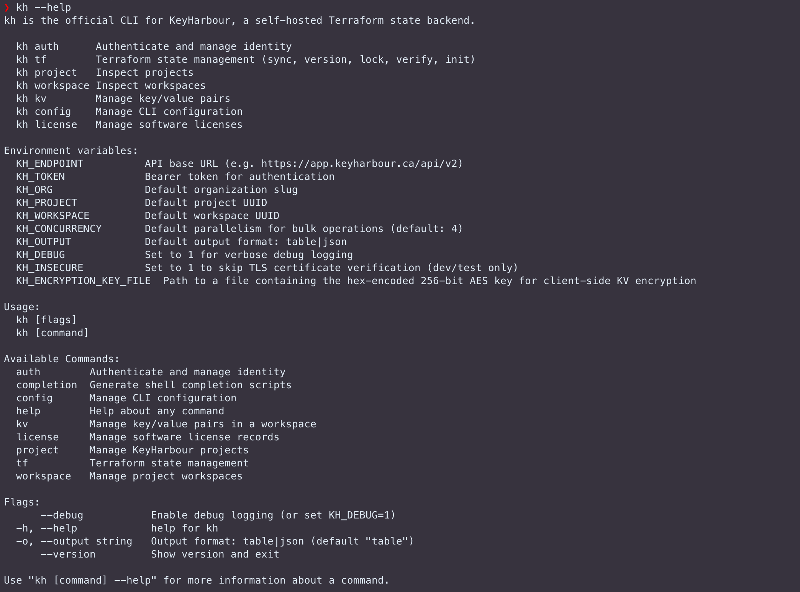

---

## 🛠️ Prerequisites

To run this application locally, you need to have the following installed on your machine:
* [Docker Desktop](https://docker.com) or [Podman](https://podman.io) (strongly recommended for macOS).
* **Docker Compose v2** (included with Docker Desktop or available via Homebrew).

---

## 📦 Quick Start with Docker Compose

The development environment is fully containerized. Follow these steps to get up and running:

### 1. Start the services
This command builds the application image and downloads the required dependent services (PostgreSQL & Meilisearch):

Here the docker compose file
```bash
services:
  db:
    image: postgres:18-alpine
    volumes:
      - postgres_data:/var/lib/postgresql
    environment:
      POSTGRES_USER: postgres
      POSTGRES_PASSWORD: your_secure_password_here
    ports:
      - "5432:5432"
    healthcheck:
      test: ["CMD-SHELL", "pg_isready -U postgres"]
      interval: 10s
      timeout: 5s
      retries: 5

  meilisearch:
    image: getmeili/meilisearch:v1.54
    ports:
      - "7800:7700"
    environment:
      - MEILI_MASTER_KEY=your_meilisearch_master_key_here
      - MEILI_ENV=development
    volumes:
      - meili_data:/meili_data

  web:
    image: keyharbour/keyharbource:latest
    command: bash -c "rm -f tmp/pids/server.pid && bundle exec rails s -b '0.0.0.0'"
    volumes:
      - bundle_cache:/usr/local/bundle
      - key_harbour_storage:/rails/storage
      - key_harbour_log:/rails/log
    ports:
      - "3000:3000"
    environment:
      - RAILS_ENV=development
      - DB_HOST=db
      - RAILS_ENV=production
      - POSTGRES_USER=postgres
      - POSTGRES_PASSWORD=your_secure_password_here
      - MEILISEARCH_HOST=http://meilisearch:7700
      - MEILI_MASTER_KEY=your_meilisearch_master_key_here
    depends_on:
      db:
        condition: service_healthy
      meilisearch:
        condition: service_started

volumes:
  postgres_data:
  meili_data:
  bundle_cache:
  key_harbour_storage:
  key_harbour_log:
```

And the command to start the application
```bash
docker compose up --build
```

### 2. Initialize the Database
The database are created on the first run, but in cas eyou need to regenerate you can use the following command :
```bash
docker compose exec web rails db:create db:migrate
```

### 3. Access the Application
Once the boot process is complete, open your browser and navigate to:
* **Rails Web Application**: [http://localhost:3000](http://localhost:3000)
* **Meilisearch Dashboard**: [http://localhost:7700](http://localhost:7800)

---

## 🔒 Security & Environment Variables

The application uses native Active Record database column encryption. Upon the very first boot (`docker compose up`), the container initialization script (`docker-entrypoint.sh`) automatically generates a persistent file containing your development cryptographic keys. This data are store in the persistent volume /rails/storage/

To manually override or declare these keys, manage them in a /rails/storage/ folder at the root level:
```text
ACTIVE_RECORD_ENCRYPTION_PRIMARY_KEY=your_primary_key_here
ACTIVE_RECORD_ENCRYPTION_DETERMINISTIC_KEY=your_deterministic_key_here
ACTIVE_RECORD_ENCRYPTION_KEY_DERIVATION_SALT=your_salt_here
```

---

## 🧪 Running the Test Suite

Tests are built using RSpec. To execute the automated test suites inside the containerized environment, run:
```bash
docker compose exec web bundle exec rspec
```
*Note: The production licensing system and strict identity verifications are automatically skipped within the test environment to guarantee continuous integration (CI) safety.*

---

## 📄 License

KeyHarbourCE is an open-source project distributed under the terms of the **Business Source License 1.1 (BSL 1.1)**.

* You are fully permitted to use the source code for development, testing, and non-commercial purposes.
* Commercial production use is restricted subject to the clear provisions detailed in the `LICENSE` file.
* The source code automatically converts to a standard open-source license Apache License, Version 2.0 after a specified time frame.

Please read the full [LICENSE](LICENSE) file for comprehensive usage terms.

---
© 2025-2026 KeyHarbour Communauty Edition — Maintained by Ikigai Lab Inc.

